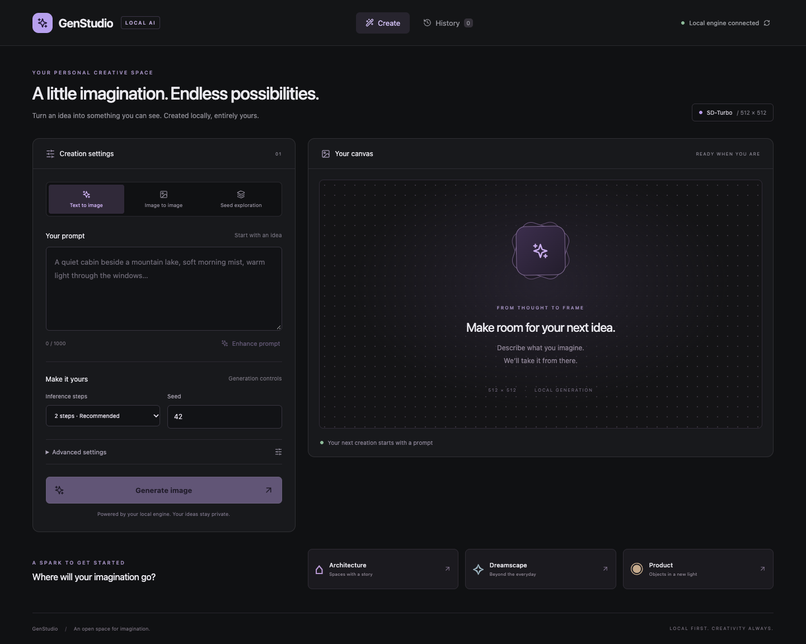
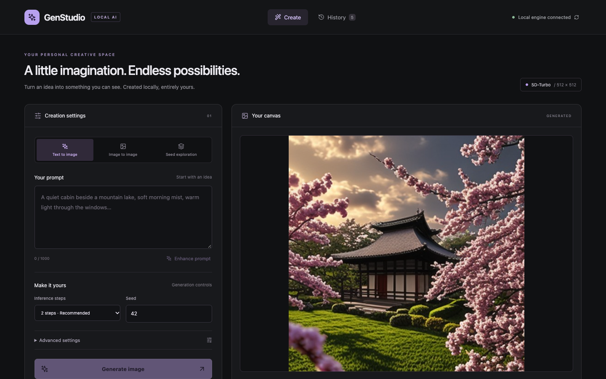

# GenStudio: Local Generative AI Studio & Multimodal Workbench

[](https://pytorch.org/)
[](https://fastapi.tiangolo.com/)
[](https://react.dev/)
[](https://vitejs.dev/)
[](https://ollama.ai/)
[](https://opensource.org/licenses/MIT)

> **GenStudio** is a privacy-first, 100% local Generative AI creative studio and research workbench. It combines ultra-fast diffusion synthesis, retrieval-augmented prompt engineering, multimodal computer vision perception, and closed-loop agentic evaluation without relying on paid third-party APIs or cloud services.

**Author:** Kailasa Charan

---

## 📸 Demo Showcase

### 1. Studio Workspace
The core creative canvas providing prompt engineering, style assistance, generation controls, and real-time inspector telemetry.



### 2. Live Generation & Multimodal Perception
High-fidelity generation paired with automated BLIP vision captioning, OpenCLIP semantic alignment scoring, and autonomous critique.



---

## 🌟 What is GenStudio?

GenStudio demystifies generative diffusion models by turning the synthesis pipeline into a transparent, observable workflow. Rather than treating diffusion as an opaque black box, GenStudio exposes:

1. **Low-Latency Synthesis:** Sub-2-second generation using Adversarial Diffusion Distillation (SD-Turbo).
2. **Retrieval-Augmented Generation (RAG):** Semantic search over curated artistic styles combined with local LLM prompt expansion.
3. **Multimodal Perception (Vision-to-Language):** Automatic image understanding via BLIP captioning and browser-native Text-to-Speech narration.
4. **Objective Alignment Evaluation:** Direct image-text cosine similarity measurement via OpenCLIP ViT-B-32.
5. **Visual Critic AI Agent:** An autonomous visual feedback loop that diagnoses missing details and iteratively refines prompts.
6. **Latent Manifold Navigation (Slerp):** Spherical linear interpolation between random seeds without variance collapse.
7. **Parameter-Efficient Adaptation (LoRA):** Dynamic loading and scaling of rank-decomposed cross-attention weights.

---

## 🧠 System Architecture

```
[ User Prompt ]
       │
       ▼
1. Style Retrieval (MiniLM-L6-v2 384-d Cosine Similarity)
       │
       ▼
2. Prompt Enhancement (Local Qwen 2.5 3B via Ollama)
       │
       ▼
3. Latent Space Initialization (Gaussian Noise / Input Image / Slerp)
       │
       ▼
4. Fast Denoising Pipeline (SD-Turbo ADD Diffusion + Optional LoRA)
       │
       ▼
5. Pixel Reconstruction (VAE Decoder: 64×64×4 → 512×512×3)
       │
       ▼
6. Multimodal Perception (BLIP Vision Captioning + Speech Synthesis)
       │
       ▼
7. Objective Semantic Scoring (OpenCLIP ViT-B-32 Alignment)
       │
       ▼
8. Autonomous AI Critic (RLVF-Inspired Closed-Loop Prompt Refinement)
```

---

## 🎨 Core Generative Modalities

| Modality | Input | Description |
| :--- | :--- | :--- |
| **Text-to-Image (T2I)** | Text Prompt | Synthesizes original 512×512 images in 1 to 4 steps from Gaussian noise. |
| **Image-to-Image (Img2Img)** | Reference Image + Prompt | Re-synthesizes images guided by user sketches or photos with adjustable denoising strength ($\eta$). |
| **Latent Slerp (Manifold)** | Seed A + Seed B | Smoothly walks the hypersphere latent manifold between two seeds with constant variance. |
| **LoRA Adaptation** | Adapter Path + Scale | Dynamically blends rank-decomposed adapter weights ($W = W_0 + \alpha \Delta W$) into cross-attention layers. |

---

## 🛠️ Prerequisites & Installation

### Requirements
* **Python:** 3.10, 3.11, or 3.12
* **Node.js:** v18+ and npm
* **Hardware:** Any modern system with GPU acceleration (Apple Silicon MPS or NVIDIA CUDA) or CPU fallback
* **Ollama:** Installed locally with `qwen2.5:3b`

---

## 🚀 Quickstart Guide

### 1. Clone the Repository
```bash
git clone https://github.com/SAICHARAN704SDF/GenStudio.git
cd GenStudio
```

### 2. Pull the Local LLM Model
Ensure the Ollama service is running and pull the prompt enhancement model:
```bash
ollama run qwen2.5:3b
```
*(You can exit the interactive prompt with `/bye`; Ollama continues serving in the background).*

### 3. Start the Backend
```bash
cd backend

# Create virtual environment
python3 -m venv .venv
source .venv/bin/activate

# Install dependencies
pip install -r requirements.txt

# Start backend server
uvicorn app.main:app --host 127.0.0.1 --port 8000
```
Backend API will be accessible at `http://127.0.0.1:8000/api/health`.

### 4. Start the Frontend
In a new terminal window:
```bash
cd frontend

# Install dependencies
npm install

# Start Vite dev server
npm run dev
```
Open [`http://localhost:5173`](http://localhost:5173) in your browser.

---

## 📁 Repository Structure

```
GenStudio/
├── backend/
│   ├── app/
│   │   ├── config.py            # Device selection (MPS/CUDA/CPU) & model IDs
│   │   ├── main.py              # FastAPI server entrypoint & CORS
│   │   ├── routes/
│   │   │   ├── enhance.py       # RAG style augmentation endpoint
│   │   │   ├── generate.py      # T2I, Img2Img, Slerp synthesis & evaluation
│   │   │   ├── health.py        # System health and hardware diagnostics
│   │   │   └── history.py       # Session history management
│   │   └── services/
│   │       ├── captioner.py     # BLIP vision-to-language captioning
│   │       ├── critic.py        # Visual Critic AI prompt refinement
│   │       ├── evaluator.py     # OpenCLIP ViT-B-32 alignment scoring
│   │       ├── generator.py     # SD-Turbo diffusion engine & Slerp
│   │       ├── history_store.py # Local JSON history persistence
│   │       └── rag.py           # In-process MiniLM vector search
│   ├── data/
│   │   ├── sample_style_lora.safetensors # Pretrained LoRA adapter weights
│   │   └── style_snippets.json           # Curated style knowledge base
│   └── requirements.txt         # Core Python dependencies
│
├── frontend/
│   ├── index.html               # Frontend HTML root
│   ├── package.json             # React & Vite dependencies
│   ├── vite.config.js           # Vite dev build config
│   └── src/
│       ├── App.jsx              # Main Studio canvas application
│       ├── studio.css           # Studio interface styling
│       ├── main.jsx             # React DOM root mounting
│       ├── services/
│       │   └── api.js           # REST API client
│       └── components/          # Reusable modular UI components
│
├── screenshots/
│   ├── studio_workspace.png     # Workspace interface screenshot
│   └── studio_generation.png    # Live generation & evaluation screenshot
│
├── run_backend.sh               # One-click backend startup script
├── run_frontend.sh              # One-click frontend startup script
├── .gitignore                   # Git exclusion configuration
└── README.md                    # Project documentation
```

---

## 🔒 Security & Privacy

* **100% Local Inference:** Zero user prompts, reference images, or generated artwork are transmitted to external servers.
* **Local Foundation Models:** All diffusion models, LLMs, vision-language captioners, and embedding models run entirely on your own device.
* **Open Source Stack:** Built on PyTorch, Hugging Face Diffusers, Transformers, FastAPI, and React.

---

## 📄 License

This project is licensed under the [MIT License](LICENSE).
